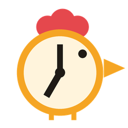
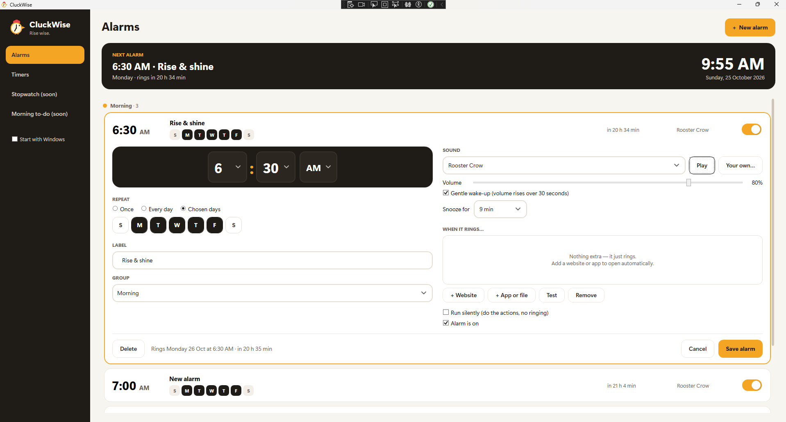

<p align="center">
  
</p>

<h1 align="center">CluckWise</h1>
<p align="center"><b>Rise wise.</b> The Windows alarm clock that makes your mornings productive.</p>

<p align="center">
  
</p>

## Features

- **Alarms**: one-time, every day or chosen weekdays, organised into groups (Morning, Work, Exercise…). Edit them inline by clicking a card.
- **Snooze and gentle wake-up**: the volume rises over 30 seconds. Choose a snooze length per alarm.
- **Original sounds**: Rooster Crow, Sunrise Chime, Gentle Beep, Classic Bell and Marimba, all synthesised in code. You can also use your own MP3/WAV files.
- **"When it rings…" actions**: open a website, app, file or folder automatically. *Run silently* turns an alarm into a scheduled task.
- **Morning to-do and streak**: dismiss a morning alarm to see your daily checklist. Mornings without snoozing build your streak.
- **Timers**: several countdowns at once, with quick presets (1, 5, 10, 25 min focus, 1 hour).
- **Stopwatch** with laps.
- **Runs in the tray** and can **start with Windows**, so alarms ring after a restart.
- **Keyboard shortcuts**: Space to dismiss, S to snooze, Ctrl+N for a new alarm, Esc to close a card.

## Requirements

- Windows 10 or 11
- [.NET 8 SDK](https://dotnet.microsoft.com/download/dotnet/8.0) (to build), or the .NET 8 Desktop Runtime (to run a build)

## Building

```powershell
git clone https://github.com/efraimray/cluckwise.git
cd cluckwise/src/CluckWise
dotnet run
```

Or open `src/CluckWise/CluckWise.csproj` in Visual Studio 2022 (with the ".NET desktop development" workload) and press F5.

## Where data is stored

Alarms, timers and settings are saved to `%AppData%\CluckWise\data.json`. Settings → *Open data folder* opens it.

## Project layout

| File | Purpose |
|---|---|
| `App.xaml(.cs)` | Colours, control styles, tray icon, single-instance startup |
| `MainWindow.xaml(.cs)` | Sidebar, next-alarm card, grouped alarm list |
| `AlarmEditorPanel.xaml(.cs)` | Inline alarm editor |
| `RingWindow.xaml(.cs)` | Ringing popup and "Good morning" checklist |
| `TimersPage`, `StopwatchPage`, `MorningPage`, `SettingsPage` | The other sidebar pages |
| `Scheduler.cs` | Checks alarms and timers every second |
| `Sounds.cs` | Synthesised alarm sounds and playback |
| `Morning.cs` | Morning checklist and streak rules |
| `Storage.cs`, `Models.cs` | Data model and saving |

## Roadmap

- [ ] Wake the PC from sleep for alarms
- [ ] Reminders before alarms
- [ ] More actions (lock, sleep, turn off monitor)
- [ ] Dark mode
- [ ] Installer and code signing

## Author

Made by **Efraim Ray**. Visit [efraimray.com](https://efraimray.com).

## License

Copyright © 2026 [Efraim Ray](https://efraimray.com). **All rights reserved.**

The source code is published so you can read it. It is not open source: you may not copy, modify, distribute or sell it, or use it in other projects, without written permission. See [LICENSE](LICENSE).
